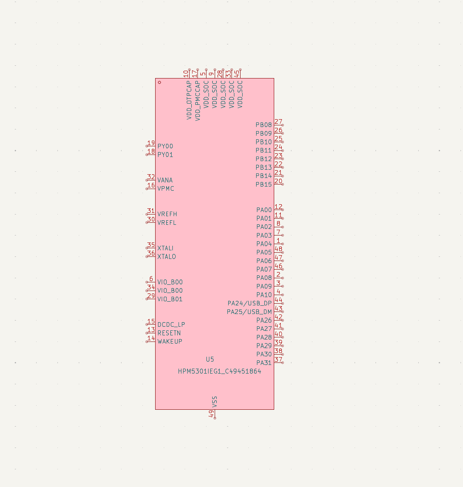
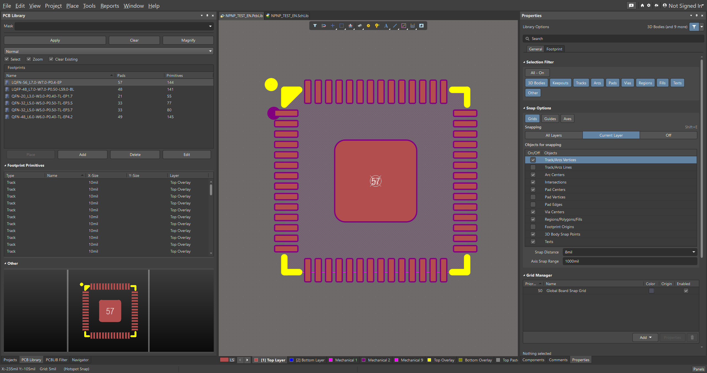
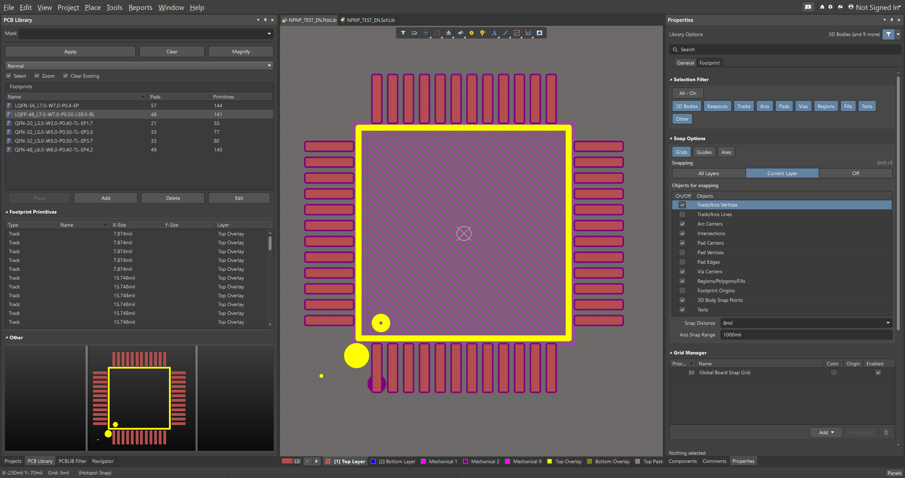
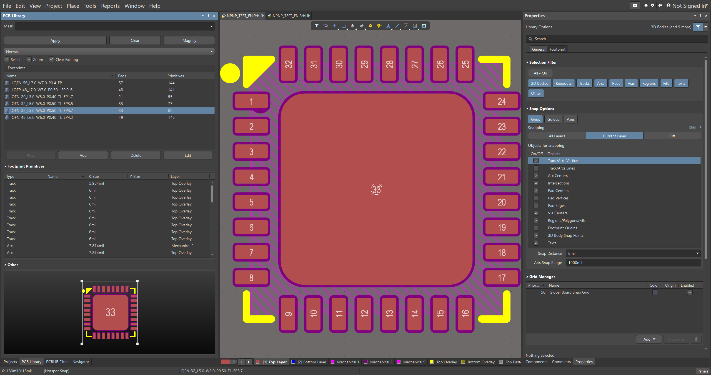
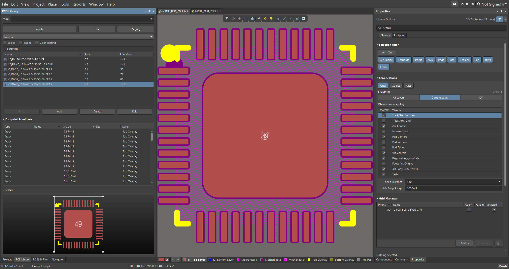
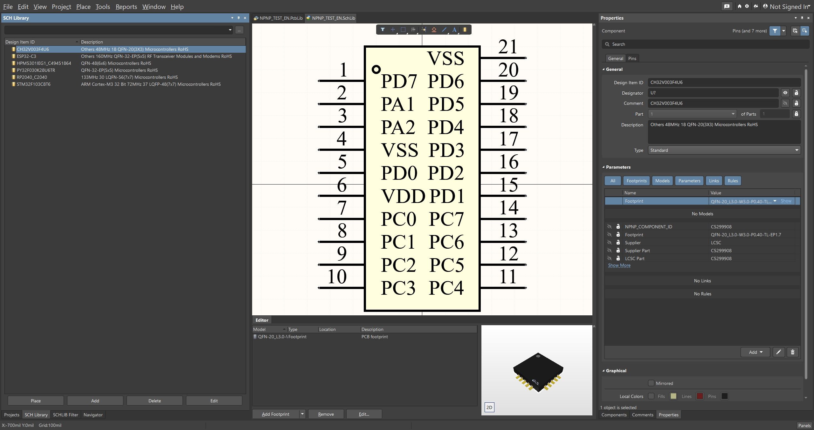
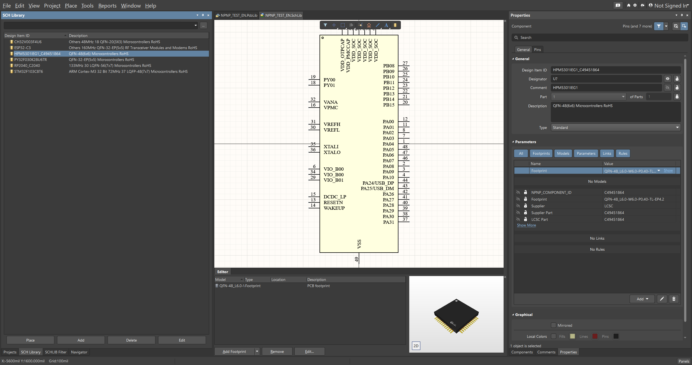
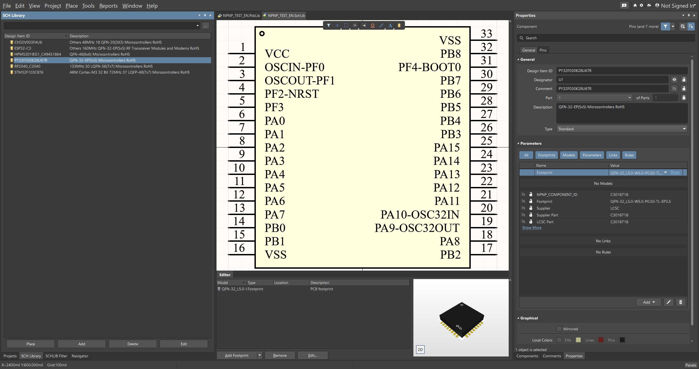
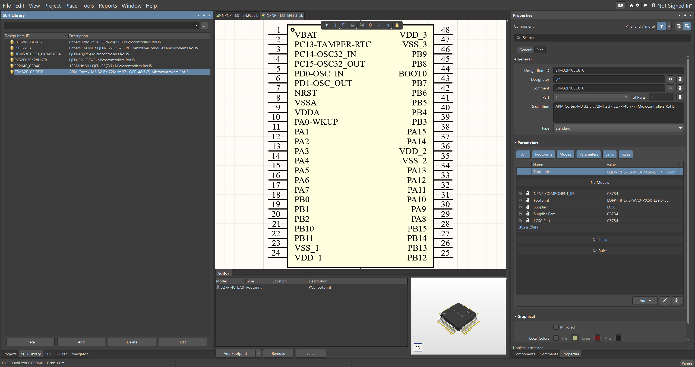

  

<h1 align="center">SeEx</h1>

  <strong>Seek &amp; Export</strong> - Clipboard component manager and EDA library exporter

  

<a href="README.md">简体中文</a>

---

## Before You Start

> Please read this section carefully, or at least read the [LICENSE](LICENSE) file.
>
> From the beginning of the project to its completion on 2026-08-03, development has taken more than half a year in total.

The project history, in chronological order:

- The project began with `nlbn` (Nice Library Bring now). It was open-sourced and received attention, but was copied directly and uploaded to Gitee. I stopped maintaining `nlbn` and removed the related crate.
- While developing `nlbn`, I reverse-engineered parts of the Altium Designer file formats and gradually created `npnp` (Normalize Pin Net Pad). It was also open-sourced, and was copied as well. A rough Tauri 2 GUI was created around it and helped some users.
- The GUI tool became the current `seex`. Until the latest refactor, it called the `npnp` CLI for exports. SeEx now contains the required exporter code directly and uses egui/eframe, so only SeEx is maintained going forward.
- If you want this project to continue receiving long-term maintenance, please email me to discuss implementation details. Direct pull requests will not be merged. Email: `lampmud@163.com`.
- Please do not misuse or create unauthorized forks or rewrites of this project. Feature requests can be opened as issues. GitHub is used primarily for GitHub Actions and multi-platform binary distribution.
- If you make a fork or rewrite, at minimum keep clear attribution to the original project.
- Please do not rewrite this tool in Python. Thank you for understanding.

## Using SeEx

SeEx monitors clipboard text containing LCSC component IDs, helps organize component lists, and exports Altium or KiCad libraries.

### 1. Start Listening

Launch SeEx and copy text containing LCSC IDs. SeEx automatically recognizes and displays matching components.

Supported formats include `C2040`, `C2040,C503870`, and IDs embedded in ordinary text.

### 2. Review Matches

The matched-component list lets you:

- Review recognized LCSC IDs
- Remove unwanted IDs
- Clear the current list
- Save matches as a BOM CSV
- Choose Chinese or English component metadata

### 3. Export EDA Libraries

Open the export page and choose a target:

- **Altium**: SchLib, PcbLib, or full-library export
- **KiCad**: symbol, footprint, 3D model, or full-library export

Choose the output directory and start the export. The result shows success count, failed count, failed IDs, and total elapsed time.

### Export Examples

KiCad exports symbols, footprints, and 3D models:

<table>
  <tr>
    <td align="center"> Symbol library</td>
    <td align="center"> Footprint library</td>
    <td align="center"> 3D model</td>
  </tr>
</table>

  
Altium PCB library examples

  <table>
    <tr>
      <td></td>
      <td></td>
      <td></td>
    </tr>
    <tr>
      <td></td>
      <td></td>
      <td></td>
    </tr>
  </table>

  
Altium SchLib examples

  <table>
    <tr>
      <td></td>
      <td></td>
      <td></td>
    </tr>
    <tr>
      <td></td>
      <td></td>
      <td></td>
    </tr>
  </table>

### 4. Merge Libraries

For Altium, enable merge to write multiple components into one SchLib/PcbLib library. Set a library name to create or append to the selected library.

KiCad full export creates the symbol library, footprint library, and 3D model directories in the output directory.

### 5. Adjust Export Speed

Parallelism controls how many components are processed at once. Higher values can improve speed but increase network and system resource usage. Start with `4` or `8` and adjust for your system.

Existing files are skipped by default. Enable Force Overwrite when you need to regenerate them.

## Output Location

The default output directory is `export` beside the application. You can change it on the export page.

Common output files include:

- Altium `.SchLib` and `.PcbLib`
- KiCad `.kicad_sym`, `.pretty`, and `.3dshapes`
- BOM `.csv`

## Releases

Windows users can install the x64 `setup.exe` or run the portable `.exe`. Windows ARM, Linux x64/ARM64, and macOS Intel/Apple Silicon archives are available from GitHub Releases.

These platform builds are provided through GitHub Actions and have not all been tested on physical hardware. Use the matching platform package and follow its normal installation method.

## Language And Settings

Use the language button in the top bar to switch between Chinese and English. The pin button keeps SeEx above other windows.

## License

Copyright (c) Ref42. All rights reserved.
